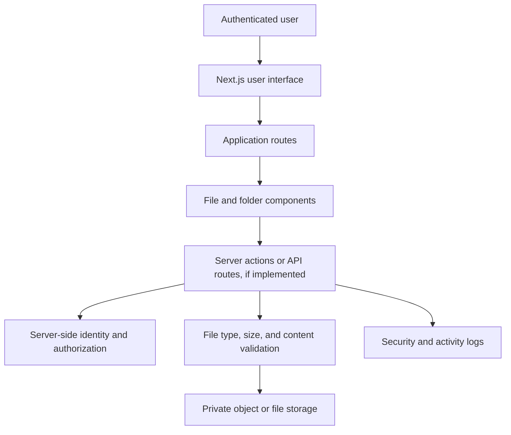

# Secure File Manager

A web application built with Next.js, TypeScript, and a component-based React interface. The repository provides the frontend foundation for a file-management experience. Review the implementation and configured storage services before treating any feature as a production security boundary.

## Important security note

A file manager handles potentially sensitive user content. A polished interface does not make file operations secure. Authentication, authorization, ownership checks, file validation, storage isolation, download permissions, malware scanning, audit logging, and rate limiting must be enforced by trusted server-side code. Never rely on client-side checks alone.

## Technology

The repository includes:
- Next.js application framework
- React and TypeScript
- Tailwind CSS
- shadcn/ui configuration and reusable components
- npm-compatible project metadata and a committed pnpm lockfile

Use the package manager and lockfile that the repository currently standardizes on. Do not regenerate or replace lockfiles as part of documentation-only changes.

## Getting started

Install the project dependencies using the package manager selected by the project, then start the development server using the scripts defined in `package.json`.

Typical Next.js commands are:

```bash
npm run dev
npm run build
npm run start
npm run lint
```

If the repository's package scripts differ, treat `package.json` as the source of truth.

## Architecture overview



This diagram represents the security architecture that a production file manager should enforce. Confirm each service and route against the current source before relying on it. Do not assume that a storage provider, database, or authentication integration exists merely because it appears in this conceptual flow.

## Repository areas

- `app/`: Next.js application routes and layouts.
- `components/`: Reusable interface components.
- `hooks/`: Shared React hooks.
- `lib/`: Shared utilities and application logic.
- `public/`: Static public assets.
- `styles/`: Global and component styling.
- `components.json`: UI component generator configuration.
- `next.config.mjs`: Next.js configuration.
- `tailwind.config.ts`: Tailwind configuration.

## Security requirements for file operations

Any production implementation should enforce all of the following on the server:

1. Authenticate the requester for every private operation.
2. Verify that the requester owns or is authorized to access the requested file.
3. Generate storage keys server-side. Do not trust user-supplied filesystem paths.
4. Normalize and validate filenames to prevent path traversal.
5. Enforce upload size limits and allowlisted file types.
6. Treat MIME type and file extension as hints, not proof of content.
7. Store private files outside a public web root or in a private object-storage bucket.
8. Use short-lived, scoped download URLs where appropriate.
9. Prevent cross-user identifier guessing from granting access.
10. Log security-relevant operations without logging file contents or credentials.

## Development and verification

- Keep UI components focused and typed.
- Validate all server inputs at the boundary.
- Avoid exposing secrets through `NEXT_PUBLIC_*` variables.
- Add tests for unauthorized access, cross-user access, invalid file types, oversized uploads, and path traversal attempts.
- Run the project's lint, type-check, and production build commands before release.

## Deployment checklist

- [ ] Authentication is configured and enforced server-side.
- [ ] File ownership is checked for every read, update, and delete.
- [ ] Storage is private by default.
- [ ] Upload size and type limits are enforced server-side.
- [ ] Filenames and storage keys cannot escape the intended namespace.
- [ ] Secrets are configured in the deployment environment.
- [ ] HTTPS is enabled.
- [ ] Logs do not expose file contents or sensitive tokens.
- [ ] Backup and retention policies are documented.
- [ ] Authorization and abuse cases are tested.

## Troubleshooting

| Problem | Checks |
| --- | --- |
| Development server fails | Verify Node.js version and installed dependencies |
| Type errors | Run the configured type-check command and inspect the first reported error |
| Upload fails | Check request limits, server validation, storage credentials, and provider response |
| Download is denied | Verify authentication, file ownership, and signed URL expiry |
| File appears public | Review storage bucket permissions and route authorization immediately |

## Contributing

See [CONTRIBUTING.md](CONTRIBUTING.md) for development expectations. Security issues should be reported privately, not in public issues.

## License

See [LICENSE](LICENSE) for license terms.
