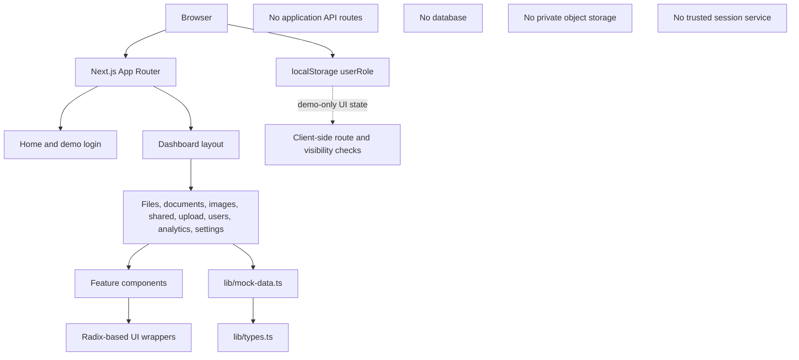

# Architecture

## 1. System summary

The application is a Next.js App Router UI built around client-side interactions and local fixture data. There is no application backend in the current repository. The architecture therefore describes the composition of the interface, not a production secure-file service.

The nodes labelled as absent are intentional documentation. A successful Next.js build does not create these services.

## 2. Framework and application shell

- `app/layout.tsx` provides the root HTML document, Inter font configuration, metadata, theme provider and toaster.
- `app/page.tsx` renders the introductory screen and `LoginForm`.
- `app/globals.css` defines design tokens, utility-layer components, card styles, file/category colours, glass effects, depth effects, and motion.
- `tailwind.config.ts` maps CSS variables to Tailwind semantic colours and enables the animation plugin.
- `next.config.mjs` controls Next build behaviour, image optimization and production console handling.

## 3. Routing and layout

The dashboard is grouped under `app/dashboard/`. The shared layout reads `userRole` from browser local storage and controls loading/redirect presentation. Nested pages provide the file dashboard, category views, shared records, upload form, user administration, analytics and settings.

This is only client-side presentation routing. The server does not derive a trusted identity or authorize a resource request. A visitor can change browser storage and bypass a hidden-link or client redirect.

See [ROUTES.md](ROUTES.md) for the full route map.

## 4. Feature components

Feature-specific components live in `components/`:
- login and sidebar;
- file grid and list;
- file preview dialog;
- user assignment and folder permission dialogs;
- add-user dialog;
- folder management;
- recent activity;
- theme provider and view toggle.

Reusable low-level interactions live in `components/ui/`. The local UI wrappers provide consistent presentation and interaction semantics. They are not business services, identity services or authorization middleware.

See [COMPONENT-REFERENCE.md](COMPONENT-REFERENCE.md).

## 5. Data and state

- `lib/types.ts` declares FileType, UserType, FolderType, FolderPermissionType and Permission.
- `lib/mock-data.ts` exports sample files, users, folders and folder permissions.
- Page components copy or filter these arrays into React state.
- Dialogs make local changes and pass callbacks to their parents.
- No repository service, database client, object-store adapter, API route, server action or persistence layer exists.

A refresh/remount may reset state changes. Read [DATA-MODEL.md](DATA-MODEL.md).

## 6. Browser/server boundary

The application uses client components where hooks, event handlers, local storage, browser APIs or dialogs are needed. Server-rendered route components and root layout still execute within Next.js, but browser-side state is not server trust.

Treat form values, role labels, user IDs, file IDs, names, types, sizes and permission choices as untrusted input if a backend is later added. Never trust a client-supplied role or owner field to make an authorization decision.

## 7. Current data flow examples

### Login
The visitor chooses a role. The form waits using a timer, writes the role to local storage and redirects to the dashboard. Email and password are not sent to a server.

### Upload
The visitor selects a local File object and mock users. Submission toggles a loading state, waits using a timer and navigates back to the dashboard. File bytes are not transmitted.

### User/folder permissions
Dialogs edit local state and call callbacks. Parent handlers may log the data or show a toast. No durable permission mutation occurs.

### File preview
The preview dialog renders generic placeholder content by file category. It does not fetch a file object.

## 8. Production target

A real service should separate:
1. Identity and session service.
2. Authenticated application API.
3. Server-side authorization policy engine.
4. Metadata database with user, tenant, folder, file, version and permission relationships.
5. Private object storage.
6. Quarantine and asynchronous scanning pipeline.
7. Safe preview/conversion service.
8. Short-lived authorized download delivery.
9. Audit, monitoring, retention, backup and recovery systems.

Do not connect the existing UI to real private files before designing and testing these trust boundaries.
