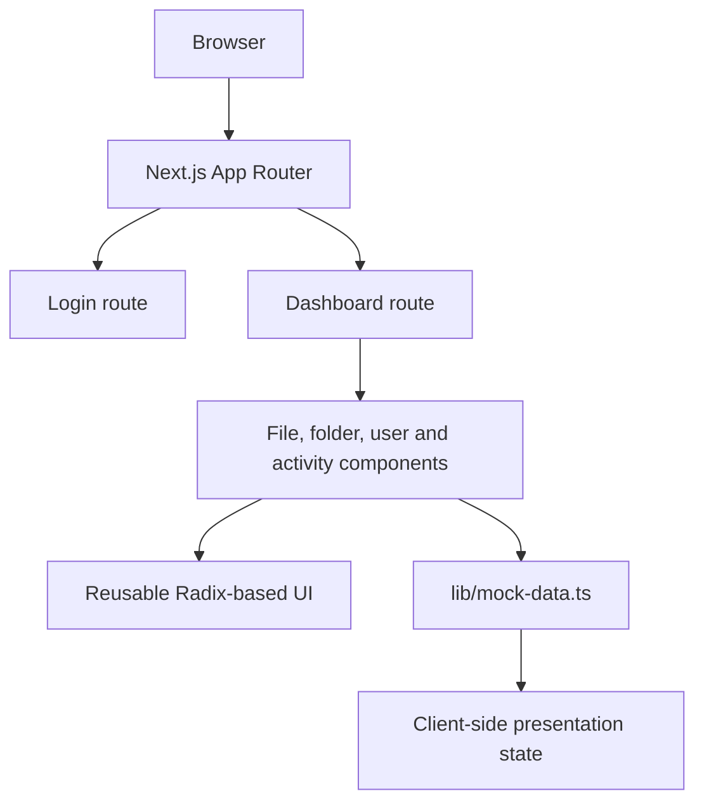

# Architecture

## Current application
The project uses the Next.js App Router. Route components are under `app/`, feature components under `components/`, and TypeScript models and fixtures under `lib/`.

## Important boundary
The current dashboard imports `mockFiles` from `lib/mock-data.ts` and reads a role from browser local storage. This is demonstration behavior. It is not a trusted identity provider, database, storage service, or access-control layer.

## Production architecture still required
A production implementation needs authenticated server routes or server actions, a database for metadata and permissions, private object storage for bytes, and authorization checks performed on the server for every operation.
